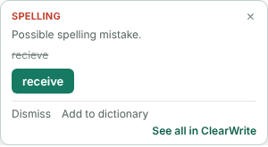
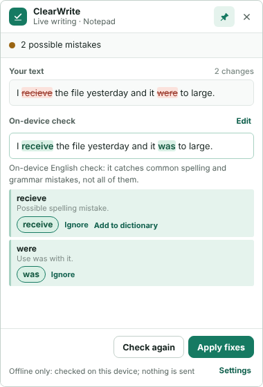
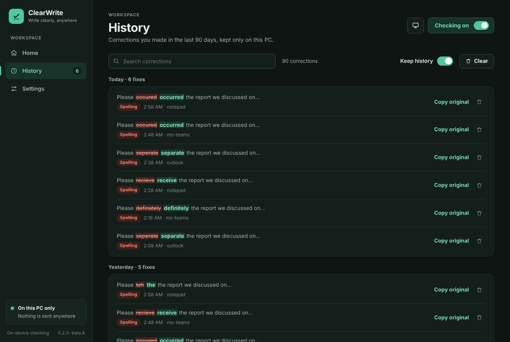
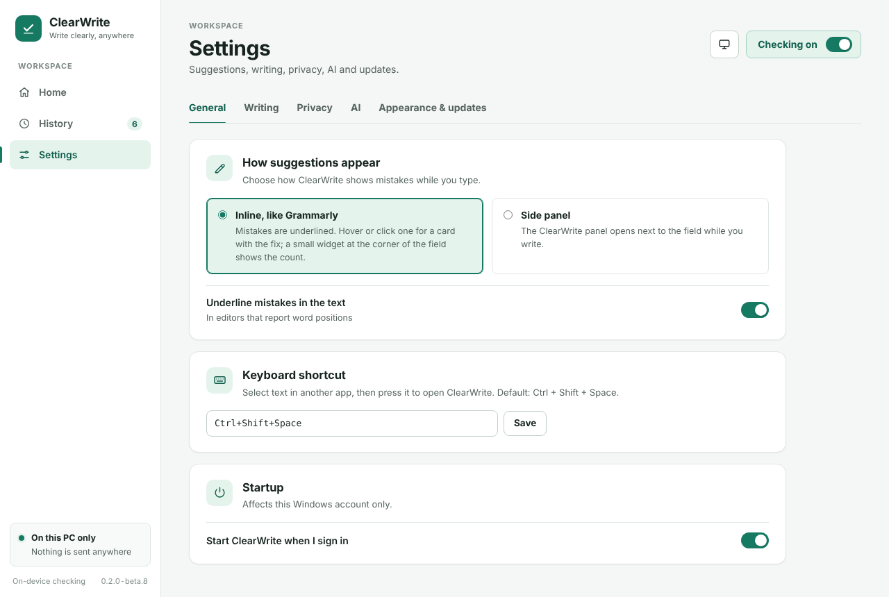

# ClearWrite

ClearWrite is a Windows desktop writing assistant. It checks spelling and basic grammar while you write, **on your device by default**: no account, API key, or internet connection is needed. AI-assisted correction and AI rewrites (Gemini or ChatGPT) are optional and only used after you opt in.

## Screenshots

Home shows today's fixes, words checked and a 30-day chart (sample data):


| While you write | Side panel |
| --- | --- |
|  |  |
| Hover or click an underline for a card; one click applies the fix. | The full review, opened from the corner widget or the shortcut. |

| History (dark theme) | Settings, grouped into tabs |
| --- | --- |
|  |  |

More: [Home in dark](docs/screenshots/home-dark.png) · [Appearance and updates](docs/screenshots/settings-appearance-dark.png) · [Side panel in dark](docs/screenshots/panel-dark.png) · [Card in dark](docs/screenshots/suggestion-card-dark.png)

## Features

- **Live writing monitor:** off by default. When enabled, the compact panel appears the first time you actually edit proofreadable text in an editable field (focusing a field, reading, or selecting does not open it). Review waits until you pause typing. Browser address bars, URL-only input, and text without enough sentence-like content are ignored. Links inside prose are shielded during correction and restored exactly afterward. Read-only documents, password fields, and excluded apps are ignored.
- **Offline proofreading (default):** the bundled Harper checker finds common English spelling and grammar mistakes on your device. Nothing is sent anywhere. See [Offline proofreading and AI-assisted mode](#offline-proofreading-and-ai-assisted-mode).
- **AI-assisted mode (opt-in):** when you choose it, eligible text is sent to your selected provider after you pause for context-aware correction, and Rephrase, tone, Continue and Suggest a reply become available. Only paragraphs that changed are sent again; unchanged paragraphs reuse their earlier result. AI corrections are split into individual changes: a change that alters a number, a negation (not, no, never…) or a name is listed with a warning but not applied unless you accept it. If a request fails, the on-device result is shown. ClearWrite never applies a correction automatically.
- **On-device grammar model:** a small grammar model (31 MB, MIT) ships with the app and runs offline after Harper. Only its safe edits are offered: one-word changes that the bundled word statistics clearly support, and capital letters at the start of a sentence. See [Offline proofreading and AI-assisted mode](#offline-proofreading-and-ai-assisted-mode).
- **Learns from you:** ClearWrite remembers, on your device only, the changes you accept and the suggestions you ignore. A change you accept twice is suggested again automatically; a suggestion you ignore twice is shown as ignored. Review or forget what it learned in Settings > Learned corrections.
- **Writing stats and history:** Home shows mistakes fixed and words checked today, how often you accept fixes, a 30-day chart, your recent corrections and your most common mistakes. The History page lists each fix with a few words around it, searchable, with *Copy original* to paste the old text back. Everything stays on your PC: history is deleted after 90 days, can be cleared at any time, and can be turned off (counts are still kept). Reset the counts in *Settings › Privacy*.
- **A clean, modern window:** Home shows whether checking is on, where your text is checked, and what ClearWrite has learned; a switch in the header turns checking on or off. Settings are grouped into General, Writing, Privacy, AI, and Appearance & updates. Light, Dark, or System theme applies to every ClearWrite window.
- **Inline suggestions, like Grammarly (default):** while you write, ClearWrite stays out of the way. A small round widget sits at the corner of the field: a spinner while checking, a red count when there are mistakes, a green check when the text is clean. In editors that report word positions, mistakes are underlined where you type (red spelling, blue grammar, green learned); hover or click one for a card with the fix. One click applies just that fix in place; Dismiss and Add to dictionary are on the card too. Click the widget (or use the shortcut) for the full panel. Prefer the old behaviour? Choose **Side panel** under *Settings › General › How suggestions appear*.
- **Clarity notes:** the panel notes very long sentences and piled-up filler words. Notes never change your text.
- **Personal dictionary:** add names and uncommon words so they are not flagged. Stored only on your device.
- **Per-app controls:** use a blocklist, or enable an allowlist so only selected apps are monitored. The current focused app can be added from the Home page. Pause monitoring for one hour or until tomorrow from the app or tray.
- **Manual shortcut:** select text and press `Ctrl+Shift+Space` to open the assistant. The shortcut continues to work when live monitoring is paused.
- **Review before use:** see the original and suggested text, with changes highlighted. Each finding can be accepted (pick one of its options), ignored, or reset on its own; the suggestion is rebuilt from only what you accept. Copy the result, apply it to a supported text field, or, in rich documents such as mail bodies, **Apply fixes** to change only the chosen words in place. Whole rewrites in documents stay copy-only so a document is never replaced unintentionally.
- **Optional AI providers:** for AI-assisted mode, configure a Google Gemini API key, or connect ChatGPT plan usage with Sign in with ChatGPT (requires the optional DevKit, see setup).
- **Multi-monitor support:** the panel opens on the display containing the field or selection, stays put while you write on that display, and remembers a position per display (relative to that display's work area, so it survives scaling and layout changes). Drag the header to move it; resize from any edge.

ClearWrite does not read surrounding Teams/email conversations to draft replies. To suggest a reply, select the relevant text and choose **Suggest a reply**.

## Offline proofreading and AI-assisted mode

Choose the mode on the **Live writing** page (or from the tray menu). New installations start in **Offline only**.

| | Offline only (default) | AI-assisted (opt-in) |
| --- | --- | --- |
| Spelling and grammar | Harper plus the on-device grammar model | The device checks first; by default only paragraphs it could not settle go to the selected provider (or every changed paragraph, if you choose); on-device result if the request fails |
| Rephrase, tone, Continue, Suggest a reply | Not available (marked "Needs AI") | Available |
| Text sent off the device | None | Changed paragraphs of the field you are editing, after a pause, to the selected provider; selected text when you choose a manual AI action |
| Proofreading network requests | None, even when a provider is configured | Provider status, model list, and correction requests |
| Account or API key | Not needed | Gemini API key, or ChatGPT sign-in |

Data flow details:

- Application update checks are separate from proofreading. Installed Windows
  Setup copies check GitHub after startup and every six hours by default. Disable
  this in Settings > Updates for no automatic update requests. Checks do not send
  drafts, dictionary words, provider tokens or API keys; GitHub receives normal
  connection metadata such as the IP address. Downloads and installation require
  approval. Offline proofreading still works without any internet connection.

- In Offline only mode every provider request is refused inside ClearWrite before any provider code runs. Provider status checks and model lists are not fetched at startup. Buttons in Settings that set up a provider (for example **Verify and save** or **Test Gemini**) contact that provider only when you press them.
- Switching to AI-assisted affects text you write from then on. Text already on screen is not sent retroactively. Switching back to Offline only cancels any AI request in progress.
- If you choose AI-assisted before a provider is set up, text keeps being checked on the device until the provider is ready.
- Chromium's built-in spellchecker is turned off, because it downloads dictionaries from the internet. Harper replaces it.

Language and accuracy:

- The on-device checker supports **English only**. Choose American, British, Australian, Canadian, or Indian English in **Settings > English dialect**. Installations from before this release keep Indian English, which was the only dialect before; new installations start with American English.
- Text that does not look like English is skipped rather than guessed at.
- Local checking catches common spelling and grammar mistakes. It is not exhaustive and not perfectly accurate. In the bundled benchmark (small, ClearWrite-authored; see [benchmark/README.md](benchmark/README.md)) it fixes 11 of 12 spelling targets and 11 of 20 grammar/punctuation cases exactly, with no wrong changes and no flags on 26 clean cases; subject-verb agreement, your/you're, sentence capitalisation and a missing space after a period are not detected on the device. Every suggestion is shown for review: original and suggested text with changes highlighted, plus Copy and Apply. Harper detects findings; a bundled frequency dictionary and SymSpell index can expand spelling candidates, and word-pair statistics rank them using the immediately preceding and following words. This provides partial local context, not AI-level understanding. It does not generally detect real-word errors, insert missing words, or rewrite sentences. Ties and uncertain choices remain unresolved. This does not automatically replace text in your application. Short phrases with English language clues can be checked even when language identification is uncertain; isolated uncertain words are skipped. Skipped checks and unresolved findings are not reported as clean text.
- The on-device grammar model (`gec-t5-tiny`, int8 ONNX, about 31 MB; MIT; trained on Google's C4_200M synthetic data) is fetched at build time, pinned to a revision and checked by SHA-256 (`assets/models/grammar-model.json`, `npm run model:fetch`). It runs in the same background worker as Harper and adds about 200 MB of memory. On its own it rewrote half of the correct sentences in the benchmark, so ClearWrite offers only its filtered edits; see [benchmark/README.md](benchmark/README.md). Set `CLEARWRITE_OFFLINE_MODEL=0` before launch to turn it off.
- The context model is bundled (about 2.2 MB compressed), checksum-verified, and needs no download or account at runtime. It contains 30,000 words and approximately 233,000 word pairs; it is not an exhaustive dictionary. Harper still validates selected expansions against the configured dialect. If the model is missing or corrupt, basic offline checking remains available. Set `CLEARWRITE_OFFLINE_CONTEXT=0` before launch to use the basic ranker for troubleshooting.
- URLs, email addresses, paths, inline code, identifiers and acronyms are protected from local replacements. Mid-sentence capitalised spelling findings remain review-only. These protections are conservative heuristics, not guarantees for every input format.

Personal dictionary:

- Choose **Add to dictionary** on a spelling finding in the writing panel, or add words in **Settings > Personal dictionary**. Remove a word with its **×** button in Settings. Words are only added when you choose to.
- The dictionary is stored as `personal-dictionary.json` in your app-data folder, `%APPDATA%\ClearWrite\`, outside this repository. Set `CLEARWRITE_DICTIONARY_DIR` to use another folder. It is passed only to the on-device checker; it is never uploaded, sent to an AI provider, or written to logs.

Upgrading: existing installations are switched to Offline only once, with a notice on the Home page. Saved settings, the encrypted Gemini key, ChatGPT sign-in, and the selected provider and model are kept unchanged; choose AI-assisted to use them again.

## Writing panel behaviour

One lifecycle owner (`src/panel-lifecycle.js`) decides when the panel is visible. Content (status, suggestions, errors) updates in place inside the same window.

| The panel shows when… | The panel hides when… |
| --- | --- |
| you edit proofreadable text in an eligible field (not on focus alone) | you click × or press Esc (dismiss) |
| you choose **Show writing panel** in the tray, click the tray icon, or press the shortcut with nothing selected | you pause or turn off monitoring |
| you select text and press the shortcut (manual mode, the only case that takes keyboard focus) | a manual session finishes and the panel was not already open |

**Sources:** the panel shows either a manual selection (shortcut) or the live field, never a mix. A manual session ends when you close, copy, or replace it, or when you make a genuine edit in a different field than the one the selection came from. The panel then switches to that field in place, and the old selection's request and result are dropped. Brief focus changes do not end a manual session.

**More actions:** whenever the panel shows text from the field you are writing in, **More actions** offers Correct, Rephrase (improve clarity), Professional, and Friendly for that text. Each action is tied to the exact text on screen, so editing again cancels it. Results stay copy-only for apps that expose a whole document. Suggest a reply and Continue are only offered for text you explicitly select with the shortcut.

Focus changes, blur, app switches, short UI Automation read gaps, loading, results, and errors never show or hide the panel. A dismissal holds for the dismissed field. The panel returns only when you restore it or start writing in a different field. **Keep on top** (pin button or tray) makes the panel a topmost window (Electron level `pop-up-menu`, plain `HWND_TOPMOST`). Electron's default `floating` level is not used, because on Windows it re-inserts the window behind the taskbar each time it is activated, which can drop it out of the topmost band. The focus helper reports the panel's native topmost state when it changes. If a pinned, visible panel is found to have lost it, topmost is re-applied once and logged. A pinned panel still cannot cover Windows security prompts (UAC) or apps in exclusive full-screen mode, and another always-on-top app that is activated later can sit above it. When the panel is not pinned it is a normal window: when you start writing in a field or a new suggestion is ready it moves in front of other background windows, without taking focus. Windows does not let it appear above the app you are actively typing in, so keep it pinned (the default) if you want to see it while you write. The panel and the main window both say when it is unpinned. There are no timers that re-show or re-raise the window.

Text inside Remote Desktop, virtual-machine and screen-sharing viewers (for example `mstsc`) cannot be read from this PC. ClearWrite says so in its status instead of waiting for a text field. Run ClearWrite inside that session to check text there.

Review timing: a check runs 650 ms after the last detected edit (the focus helper polls every 150 ms). It needs at least 12 characters and two words. AI requests time out after 25 s, and then the on-device result is shown. A result is only used if the field and text it was computed for are still current. Already-reviewed text in the same field is reused instead of being sent again. Selections longer than 6,000 characters are checked on the device paragraph by paragraph.

Applying: every write is verified immediately before pasting. Apply checks that the field still contains exactly the reviewed text, selects all of it, and pastes only if copying the selection returns that text. Replace selection pastes only if the original text is still selected in the same field. Apply fixes (rich documents) locates each chosen word by its surrounding text, which must be unique, and confirms it before replacing just that word; it reports how many changes were applied if one cannot be verified. Your clipboard is restored afterwards in all its formats (including copied files and images), and ClearWrite's temporary clipboard content is hidden from Windows clipboard history and cloud clipboard. **Undo** puts the original text back while the field still holds the applied correction (whole-field Apply); in documents use the app's own Ctrl+Z. See [editor compatibility](docs/editor-compatibility.md#applying-changes).

## Requirements

### Download for Windows (no developer tools needed)

Get the installer or ZIP from [GitHub Releases](https://github.com/nisar87/ClearWrite/releases).
The x64 Windows package includes Electron, offline dictionaries/models, editor
readers, and the optional ChatGPT DevKit. No Node.js/npm installation is needed.
Read [Getting started](docs/GETTING-STARTED.md) for installation, provider setup,
privacy, prerequisites and limitations. Packaged data lives in `%APPDATA%\ClearWrite`.
The ChatGPT-included distribution is for **personal noncommercial use only** under
the bundled DevKit license; free distribution does not grant business-use rights.

### Building from source

- Windows 10 or 11
- Node.js 22.12 or later and npm
- Nothing else for offline proofreading
- Optional, for AI-assisted mode: a Gemini API key, or eligible ChatGPT plan access through the official [Sign in with ChatGPT DevKit](https://github.com/openai/sign-in-with-chatgpt-devkit)

## Setup From Source

Offline proofreading needs only this repository:

```powershell
git clone https://github.com/nisar87/ClearWrite.git ClearWrite
cd ClearWrite
npm ci
npm run check
npm test
npm start
```

ChatGPT sign-in is optional. It uses the DevKit's `@siwc/local` package, which is not published to npm and is declared as an optional dependency. To enable it, clone the DevKit next to ClearWrite and build it before running `npm ci` in ClearWrite:

```powershell
git clone https://github.com/openai/sign-in-with-chatgpt-devkit.git WritingAssistantDevKit
cd WritingAssistantDevKit
npm ci
npm run build -w @siwc/local
cd ..\ClearWrite
npm ci
```

The sibling folder must be named `WritingAssistantDevKit` because the optional package reference in `package.json` points to `../WritingAssistantDevKit/packages/local`. Without it, ClearWrite runs normally and shows ChatGPT as not installed. Gemini needs only an API key.

On first run there is nothing to sign in to: ClearWrite starts in Offline only mode. Select text and press `Ctrl+Shift+Space`, or turn on checking with the switch at the top of the window. To use AI, configure a provider in Settings and choose AI-assisted. The default shortcut is `Ctrl+Shift+Space`. Automatic monitoring and Windows startup are opt-in. Use the switch at the top of the window to turn checking on or off; configure additional excluded app process names in Settings.

You can also launch `start-clearwrite.vbs` after installing dependencies; it starts Electron directly without leaving a console window open and keeps runtime data and Electron cache folders relative to the checkout. `start-clearwrite.cmd` is a compatibility wrapper for launching the hidden VBS entry point.

## Privacy And Local Data

- By default, application data is stored in the project's ignored `data/` directory. Set `CLEARWRITE_DATA_DIR` to use another location.
- ChatGPT sign-in credentials are managed by the official DevKit and protected using Windows secure storage. ClearWrite does not store your ChatGPT password.
- Gemini API keys are encrypted with Electron's Windows secure storage.
- Live monitoring is disabled by default. When enabled in Offline only mode, field text is checked on the device and nothing is sent. In AI-assisted mode it sends the text of an editable field to the selected provider after a detected change and pause. UI Automation cannot always distinguish a person's keystrokes from an app changing an editable field, so exclude sensitive apps and keep monitoring paused when it is not needed. Manual actions send only the selected text and chosen action. Review each suggestion; ClearWrite never applies a live suggestion automatically.
- Automatic monitoring ignores password fields, read-only document controls, and by default ClearWrite, Command Prompt, PowerShell, Windows Terminal, and Registry Editor. Additional process names can be excluded in Settings.
- When the allowlist is enabled, ClearWrite compares the focused app's process name with the list before reading the field text. Non-allowed app text is not read or sent to a provider.
- The on-device checker uses Harper (`harper.js`, Apache-2.0) and currently checks English only, in the dialect chosen in Settings. It declines obvious non-English or uncertain text, and text checked on the device never leaves it. AI review happens only in AI-assisted mode.
- The personal dictionary is stored in `%APPDATA%\ClearWrite\personal-dictionary.json`, outside the repository, and is never logged or uploaded.
- Learned corrections are stored in `%APPDATA%\ClearWrite\learned-corrections.json` (the words you changed and what you changed them to, with counts). They are learned only from suggestions you apply, replace or copy, used only on this device, never logged or uploaded, and can be forgotten in Settings. Provider responses are never used as training data.
- `startup.log` records stages, timings, and process names for troubleshooting. It never contains the text you type, dictionary words, prompts, or keys.
- ClearWrite does not keep a draft history. Provider processing and retention are governed by the provider's terms and settings.
- Keep `data/`, `cache/`, `.env` files, local logs, and any personal dictionary private. They are excluded by `.gitignore`; do not force-add them to a public repository.

## Third-party notices

ClearWrite bundles third-party software and data under their own licenses, including Harper (`harper.js`, Apache-2.0, with its built-in English dictionary), Mnemonist (MIT), Electron (MIT), and adapted SymSpell frequency data with Google Books Ngram and SCOWL attribution. See [THIRD_PARTY_NOTICES.md](THIRD_PARTY_NOTICES.md). The optional Sign in with ChatGPT DevKit is covered by `SIWC-DEVKIT-LICENSE.txt`. Your personal dictionary contains only the words you add.

## Compatibility Notes

The reader supports capability-based ValuePattern, guarded rich TextPattern, focused legacy accessibility, bounded Scintilla current-line access and an isolated native UIA3 fallback for hosted/windowless editors. The small native interop library and its license are bundled; no additional runtime installation is needed. Newly supported fallback editors are copy-only. Actual support depends on the editor's provider; these paths do not guarantee every application works. See [editor compatibility](docs/editor-compatibility.md) for safety checks, troubleshooting and the outstanding live-app test matrix.

The Windows monitor relies on UI Automation and works only with text fields that expose usable accessibility information. Some apps, remote sessions, protected/elevated windows, and custom editors may not expose text reliably. Manual selection uses the system clipboard and keyboard input, so apps that block clipboard access may not support replacement. In those cases, copy the suggestion and paste it yourself.

## Development

Screenshots in `docs/screenshots` are made with sample data by `python scripts/screenshots/capture.py` (needs Python Playwright and Chrome); rerun it after changing the interface.

Build the Windows installer and ZIP on Windows with Node.js 22.12+:

```powershell
npm ci
npm run check
npm test
npm run dist:win
```

The built optional ChatGPT DevKit must be present as described above; distribution
builds fail rather than silently shipping without it. Output is in ignored `release/`.
The builder copies an explicit application allowlist, resolves the production
dependency closure (including DevKit dependencies), and never copies your data,
cache, logs, `.env`, personal dictionary, or Git metadata. Checksums accompany the
artifacts. See [distribution guide](docs/DISTRIBUTION.md) for release verification.

Continuous integration (`.github/workflows/ci.yml`) runs on `windows-latest` for every push: syntax check, unit tests, the editor reader fixture, Windows input integration tests (`npm run test:input`, test-owned windows only) and the offline benchmark.

Offline accuracy evaluation and model provenance are documented in [benchmark/README.md](benchmark/README.md). Run `npm run benchmark:offline` to measure the bundled checker. Benchmark results are generated locally and ignored by Git; no user drafts are collected.

```powershell
npm run check
npm test
npm start
```

ClearWrite-authored source is licensed under MIT; see `LICENSE`. The separate Sign in with ChatGPT DevKit is under its own noncommercial license, included here as `SIWC-DEVKIT-LICENSE.txt`. MIT does not extend or replace that license, grant commercial rights to DevKit code, or grant access to OpenAI services or marks. Keep the DevKit license and third-party notices intact.
